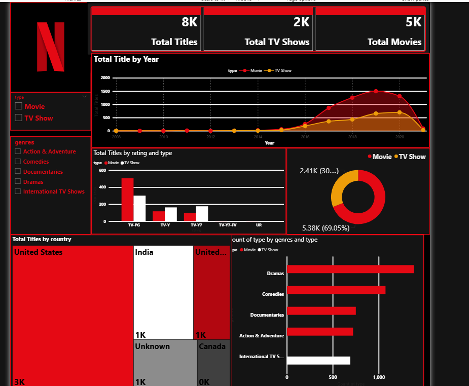
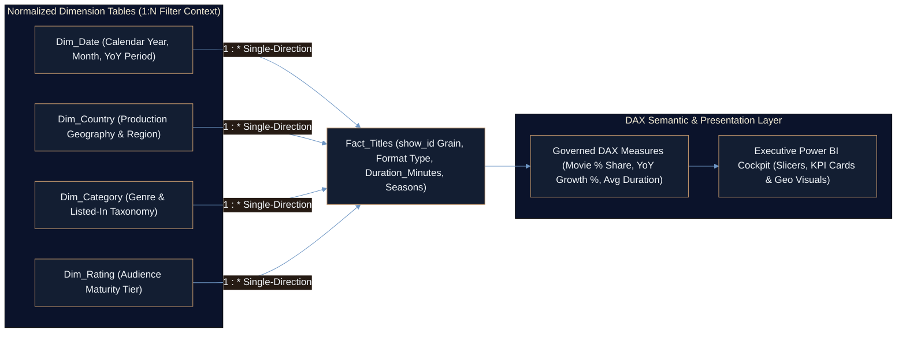

<div align="center">

# Netflix Global Business Intelligence & Executive Power BI Suite
### Dimensional Star-Schema Reporting & DAX Semantic Layer Empowering Streaming Executives to Audit Catalog Mix, Regional Supply, Maturity Positioning & YoY Growth


[](Netflix_Dashboard_New.mp4)
[](https://github.com/Ayan-Rajput-Analysis)

</div>

---

## 1. Executive Summary (Bottom Line Up Front)

> **Governing Mandate:** Static spreadsheet exports prevent content licensing executives from cross-filtering regional genre gaps, maturity-tier exposure, and year-over-year release velocity simultaneously; this interactive **Microsoft Power BI** suite consolidates global catalog KPIs into a single Star-Schema decision cockpit.

- **Self-Service Executive Cross-Filtering:** Enables 1-click drill-down across release year, producing country, format (`Movie` vs. `TV Show`), genre category, and audience maturity rating via [`Data_VIsualization.pbix`](Data_VIsualization.pbix).
- **Governed Star-Schema & DAX Semantic Layer:** Separates the central `Titles` Fact Table from normalized `Date`, `Country`, `Category`, and `Rating` dimensions—guaranteeing consistent KPI denominators across dynamic slicer states.
- **Complete Stakeholder Delivery Package:** Ships the interactive Power BI workbook ([`Data_VIsualization.pbix`](Data_VIsualization.pbix)), a 60-second executive demo video ([`Netflix_Dashboard_New.mp4`](Netflix_Dashboard_New.mp4)), a boardroom slide briefing ([`Presentation.pptx`](Presentation.pptx)), and high-resolution visual snapshot ([`Netflix_Dashboard_Pic.png`](Netflix_Dashboard_Pic.png)).

<p align="center">
  
  <br/>
  <sub><strong>Executive Cockpit Preview:</strong> High-contrast dark-themed Power BI canvas engineered for rapid 5-second KPI scanning and interactive multi-axis cross-filtering.</sub>
</p>

---

## 2. Business Context & Problem Statement (SCR Framework)

- **Situation:** Content strategy and regional licensing leaders require real-time visibility into how catalog composition evolves across geographies, maturity ratings (`TV-MA`, `TV-14`, `R`), and format durations.
- **Complication:** Flat catalog extracts mix multi-country strings, heterogeneous duration units (feature-film minutes vs. episodic seasons), and unfiltered year-over-year counts—causing inconsistent ad-hoc numbers across regional teams.
- **Resolution:** Designed a governed **Star-Schema** data model in Power BI paired with zero-division-safe **DAX** measures and a high-contrast executive layout that translates raw title metadata into self-service portfolio intelligence.

---

## 3. Star-Schema Data Model & Semantic Architecture



### Core Governed DAX Measures

```dax
Movie % Share =
DIVIDE(
    CALCULATE( COUNTROWS( Titles ), Titles[Type] = "Movie" ),
    COUNTROWS( Titles ),
    0
)

YoY Title Growth % =
DIVIDE(
    [Total Titles] - [Prior Year Titles],
    [Prior Year Titles],
    0
)

Average Duration (Min) =
CALCULATE(
    AVERAGE( Titles[Duration_Minutes] ),
    Titles[Type] = "Movie"
)
```

---

## 4. Dashboard Capabilities & Stakeholder Deliverables Matrix

| Deliverable / Analytical Module | Technical Implementation | Executive & Licensing Stakeholder Value |
| :--- | :--- | :--- |
| **[`Data_VIsualization.pbix`](Data_VIsualization.pbix)** | Interactive Power BI Desktop model with Star-Schema relationships, DAX measures & dynamic slicers | Enables live exploration of regional catalog concentration, format mix, and maturity exposure. |
| **[`Netflix_Dashboard_New.mp4`](Netflix_Dashboard_New.mp4)** | 60-second recorded interactive walkthrough of cross-filtering and slicer responsiveness | Gives time-constrained reviewers instant verification of interactive UX without installing Power BI Desktop. |
| **[`Presentation.pptx`](Presentation.pptx)** | Structured executive presentation deck synthesizing catalog trends & strategic takeaways | Ready for leadership briefings and non-technical stakeholder alignment. |
| **[`Netflix_Dashboard_Pic.png`](Netflix_Dashboard_Pic.png)** | High-contrast dark-theme visual layout following pre-attentive hierarchy principles | Surfaces headline KPIs, geographic volume, rating mix, and YoY growth in a single screen without scroll fatigue. |

---

## 5. Quality Assurance & Validation (`analysis-qa-checklist` Standard)

- **Star-Schema Cardinality Integrity:** Enforced strict `1:*` single-direction relationships from `Date`, `Country`, `Category`, and `Rating` dimensions into the `Titles` Fact Table to prevent ambiguous bi-directional filter propagation and row-count inflation.
- **Zero-Division & Filter-Context Safety:** All ratio and growth DAX formulas wrap denominators inside `DIVIDE(..., 0)` so sparse country-by-year slicer selections degrade gracefully rather than rendering `Infinity` or `NaN` on KPI cards.
- **Format-Isolated Runtime Aggregation:** `Average Duration (Min)` explicitly scopes `CALCULATE(..., Titles[Type] = "Movie")` so episodic season integers never contaminate feature-film minute averages.
- **Visual Signal-to-Noise Discipline:** Eliminated redundant gridlines and competing accent colors in favor of a focused dark canvas that highlights primary catalog shifts immediately.

---

## 6. Tech Stack

<p align="left">
  
  
  
  
  
</p>

---

## 7. Quickstart & Repository Structure

```text
CodeAlpha_-Data-Visualization/
├── Data_VIsualization.pbix       # Interactive Power BI Desktop report, Star Schema & DAX measures
├── Netflix_Dashboard_New.mp4     # 60-second executive video walkthrough of live cross-filtering
├── Presentation.pptx             # Stakeholder slide briefing summarizing key catalog insights
├── Netflix_Dashboard_Pic.png     # High-resolution static snapshot of the primary BI canvas
└── README.md                     # Semantic model specification, DAX formulas & QA documentation
```

```bash
# 1. Clone the repository locally
git clone https://github.com/Ayan-Rajput-Analysis/CodeAlpha_-Data-Visualization.git
cd CodeAlpha_-Data-Visualization

# 2. Open Data_VIsualization.pbix in Microsoft Power BI Desktop (Windows)
#    or preview Netflix_Dashboard_New.mp4 and Presentation.pptx directly on any OS.
```

---

<div align="center">
  <sub>Architected &amp; Documented by <a href="https://github.com/Ayan-Rajput-Analysis"><strong>Ayan Rajput</strong></a> • <a href="https://www.linkedin.com/in/ayan-rajput-8781a7397/">LinkedIn</a> • Data Analytics, Applied ML &amp; Production Web Systems</sub>
</div>
